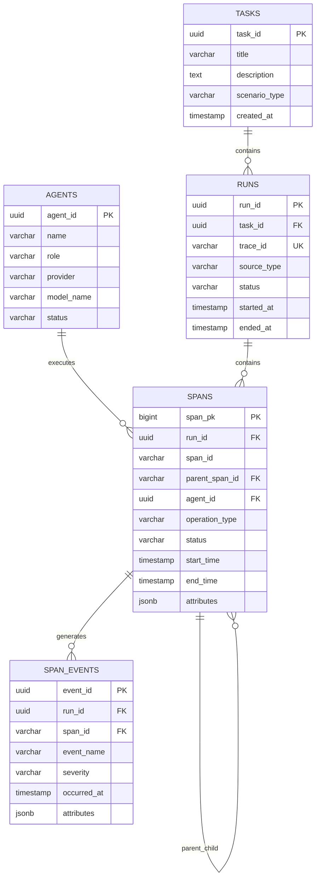

# AI Agent 执行轨迹管理与可观测性分析系统
## 数据库详细设计与 API 接口规范 V1.1

**文档用途：** 作为后端、前端、模拟器三个开发任务的统一技术依据。

**数据库：** PostgreSQL 16+

**后端：** Python FastAPI + SQLAlchemy 2.0

**接口前缀：** `/api/v1`

---

# 第一部分：数据库详细设计

## 1.1 核心数据模型

第一版采用五张核心表：

| 表名 | 主要职责 |
|---|---|
| agents | Agent 基本信息 |
| tasks | 任务定义 |
| runs | 任务执行实例，同时代表一条 Trace |
| spans | Agent 执行过程中的操作记录 |
| span_events | Span 执行过程中的事件和异常 |

核心关系：

- 一个 Task 可以有多个 Run。
- 一个 Run 对应一条 Trace。
- 一条 Trace 包含多个 Span。
- 一个 Span 可以包含多个 Event。
- 一个 Agent 可以参与多个 Span。
- Span 之间通过 parent_span_id 建立父子关系。

第一版采用一个 Run 对应一条 Trace 的简化模型，不额外建立 traces 表。

## 1.2 ER 图



## 1.3 完整 SQL 建表脚本

### 表一：agents

```sql
CREATE TABLE agents (
    agent_id UUID PRIMARY KEY DEFAULT gen_random_uuid(),

    name VARCHAR(100) NOT NULL,
    role VARCHAR(50) NOT NULL,

    provider VARCHAR(80),
    model_name VARCHAR(120),

    status VARCHAR(16) NOT NULL DEFAULT 'ACTIVE'
        CHECK (status IN ('ACTIVE', 'DISABLED')),

    created_at TIMESTAMPTZ NOT NULL DEFAULT NOW()
);
```

### 表二：tasks

```sql
CREATE TABLE tasks (
    task_id UUID PRIMARY KEY DEFAULT gen_random_uuid(),

    title VARCHAR(200) NOT NULL,
    description TEXT,

    scenario_type VARCHAR(50) NOT NULL DEFAULT 'GENERAL',

    created_at TIMESTAMPTZ NOT NULL DEFAULT NOW()
);
```

### 表三：runs

```sql
CREATE TABLE runs (
    run_id UUID PRIMARY KEY DEFAULT gen_random_uuid(),

    task_id UUID NOT NULL
        REFERENCES tasks(task_id) ON DELETE RESTRICT,

    trace_id VARCHAR(32) NOT NULL UNIQUE
        CHECK (trace_id ~ '^[0-9a-f]{32}$'),

    source_type VARCHAR(12) NOT NULL
        CHECK (source_type IN ('SIMULATED', 'REAL')),

    status VARCHAR(12) NOT NULL DEFAULT 'RUNNING'
        CHECK (
            status IN (
                'RUNNING',
                'SUCCESS',
                'FAILED',
                'CANCELLED'
            )
        ),

    started_at TIMESTAMPTZ NOT NULL DEFAULT NOW(),
    ended_at TIMESTAMPTZ,

    error_summary TEXT,

    created_at TIMESTAMPTZ NOT NULL DEFAULT NOW(),

    CHECK (
        ended_at IS NULL OR ended_at >= started_at
    ),

    CHECK (
        (status = 'RUNNING' AND ended_at IS NULL)
        OR
        (status IN ('SUCCESS', 'FAILED', 'CANCELLED')
         AND ended_at IS NOT NULL)
    )
);
```

设计说明：

- run_id 是系统内部主键。
- trace_id 是对外提供的执行链路标识。
- source_type 区分模拟任务和真实任务。
- 一个 Run 从创建开始即处于 RUNNING 状态。
- 任务完成后更新状态及结束时间。
- 不在 runs 中重复保存 Token 总量和异常总数，这些数据从 spans 统计获得。

### 表四：spans

```sql
CREATE TABLE spans (
    span_pk BIGINT GENERATED ALWAYS AS IDENTITY PRIMARY KEY,

    run_id UUID NOT NULL
        REFERENCES runs(run_id) ON DELETE CASCADE,

    span_id VARCHAR(16) NOT NULL
        CHECK (span_id ~ '^[0-9a-f]{16}$'),

    parent_span_id VARCHAR(16),

    agent_id UUID
        REFERENCES agents(agent_id) ON DELETE SET NULL,

    operation_type VARCHAR(20) NOT NULL
        CHECK (
            operation_type IN (
                'AGENT',
                'LLM',
                'TOOL',
                'RETRIEVAL',
                'WORKFLOW',
                'OTHER'
            )
        ),

    span_name VARCHAR(200) NOT NULL,

    status VARCHAR(10) NOT NULL
        CHECK (status IN ('SUCCESS', 'ERROR')),

    start_time TIMESTAMPTZ NOT NULL,
    end_time TIMESTAMPTZ NOT NULL,

    provider VARCHAR(80),
    model_name VARCHAR(120),
    tool_name VARCHAR(120),

    input_tokens INTEGER
        CHECK (input_tokens IS NULL OR input_tokens >= 0),

    output_tokens INTEGER
        CHECK (output_tokens IS NULL OR output_tokens >= 0),

    error_type VARCHAR(100),
    error_message TEXT,

    attributes JSONB NOT NULL DEFAULT '{}'::JSONB
        CHECK (jsonb_typeof(attributes) = 'object'),

    CONSTRAINT uq_run_span UNIQUE (run_id, span_id),

    CONSTRAINT fk_span_parent
        FOREIGN KEY (run_id, parent_span_id)
        REFERENCES spans(run_id, span_id)
        ON DELETE CASCADE
        DEFERRABLE INITIALLY DEFERRED,

    CHECK (end_time >= start_time),

    CHECK (
        parent_span_id IS NULL
        OR parent_span_id <> span_id
    )
);
```

设计说明：

1. span_pk 是数据库内部主键。
2. span_id 是执行链路中的 Span 标识。
3. parent_span_id 用于构建调用树。
4. agent_id 可以为空，例如某些系统级操作不属于具体 Agent。
5. operation_type 用于区分模型调用、工具调用和 Agent 操作。
6. input_tokens 和 output_tokens 只在有 Token 信息的操作中填写。
7. attributes 保存非固定的扩展信息。
8. duration_ms 不重复存储，通过 end_time - start_time 计算。

这里采用 `(run_id, span_id)` 联合唯一约束，确保不同 Run 之间可以使用相同格式的 Span ID，但同一 Run 内不能重复。

父 Span 外键采用延迟检查，允许同一个事务内批量插入父子 Span，而不强制要求客户端按照父子顺序逐条提交。

第一版仅采集已经结束的 Span。对于尚未完成的操作，由采集器暂存在内存中，结束后再写入数据库。

### 表五：span_events

```sql
CREATE TABLE span_events (
    event_id UUID PRIMARY KEY,

    run_id UUID NOT NULL,
    span_id VARCHAR(16) NOT NULL,

    event_name VARCHAR(100) NOT NULL,

    severity VARCHAR(10) NOT NULL DEFAULT 'INFO'
        CHECK (
            severity IN (
                'TRACE',
                'DEBUG',
                'INFO',
                'WARN',
                'ERROR'
            )
        ),

    message TEXT,

    occurred_at TIMESTAMPTZ NOT NULL,

    attributes JSONB NOT NULL DEFAULT '{}'::JSONB
        CHECK (jsonb_typeof(attributes) = 'object'),

    CONSTRAINT fk_event_span
        FOREIGN KEY (run_id, span_id)
        REFERENCES spans(run_id, span_id)
        ON DELETE CASCADE
);
```

event_id 由数据采集端生成并在重试时保持不变，用于避免重复事件。

## 1.4 索引设计

### 第一阶段：核心索引

```sql
-- 查询某个任务的执行历史
CREATE INDEX idx_runs_task_started
ON runs(task_id, started_at DESC);

-- 按执行状态和时间筛选
CREATE INDEX idx_runs_status_started
ON runs(status, started_at DESC);

-- 查询某条 Trace 中的全部 Span
CREATE INDEX idx_spans_run_start
ON spans(run_id, start_time);

-- 根据父 Span 查询子 Span
CREATE INDEX idx_spans_run_parent
ON spans(run_id, parent_span_id);

-- 查询某个 Agent 的执行历史
CREATE INDEX idx_spans_agent_start
ON spans(agent_id, start_time DESC);

-- 查询异常 Span
CREATE INDEX idx_spans_error_time
ON spans(start_time DESC)
WHERE status = 'ERROR';

-- 查询工具调用
CREATE INDEX idx_spans_tool_time
ON spans(tool_name, start_time DESC)
WHERE operation_type = 'TOOL';

-- 查询某条 Trace 的事件
CREATE INDEX idx_events_run_time
ON span_events(run_id, occurred_at);
```

### 第二阶段：可选 JSONB 索引

```sql
CREATE INDEX idx_spans_attributes_gin
ON spans
USING GIN(attributes jsonb_path_ops);
```

该索引主要用于 JSONB 包含查询，例如：

```sql
SELECT *
FROM spans
WHERE attributes @>
      '{"tool_category": "search"}'::jsonb;
```

GIN 索引属于实验性优化，应该在有明确 JSONB 查询需求后再建立。

不建议一开始为所有字段建立索引，因为索引会增加写入成本和存储空间。

## 1.5 典型 SQL 查询

### 查询某次任务的执行链路

```sql
SELECT
    s.span_id,
    s.parent_span_id,
    a.name AS agent_name,
    s.operation_type,
    s.span_name,
    s.status,
    s.start_time,
    s.end_time,

    ROUND(
        EXTRACT(EPOCH FROM
            (s.end_time - s.start_time)) * 1000,
        2
    ) AS duration_ms

FROM spans s

LEFT JOIN agents a
    ON s.agent_id = a.agent_id

WHERE s.run_id = :run_id

ORDER BY s.start_time;
```

前端根据 parent_span_id 组织调用树。

### 查询 Agent 平均执行时间

```sql
SELECT
    a.name,
    COUNT(*) AS span_count,

    ROUND(
        AVG(
            EXTRACT(EPOCH FROM
                (s.end_time - s.start_time)) * 1000
        ),
        2
    ) AS avg_duration_ms,

    SUM(
        COALESCE(s.input_tokens, 0)
        + COALESCE(s.output_tokens, 0)
    ) AS total_tokens

FROM spans s

JOIN agents a
    ON s.agent_id = a.agent_id

GROUP BY a.agent_id, a.name

ORDER BY span_count DESC;
```

### 查询工具调用失败率

```sql
SELECT
    tool_name,

    COUNT(*) AS total_calls,

    COUNT(*) FILTER (
        WHERE status = 'ERROR'
    ) AS failed_calls,

    ROUND(
        COUNT(*) FILTER (
            WHERE status = 'ERROR'
        )::NUMERIC
        / NULLIF(COUNT(*), 0),
        4
    ) AS failure_rate

FROM spans

WHERE operation_type = 'TOOL'

GROUP BY tool_name

ORDER BY failed_calls DESC;
```

### 查询任务 P95 执行时间

```sql
SELECT
    percentile_cont(0.95)
    WITHIN GROUP (
        ORDER BY EXTRACT(
            EPOCH FROM (ended_at - started_at)
        ) * 1000
    ) AS p95_duration_ms

FROM runs

WHERE status = 'SUCCESS'
  AND started_at >= :start_time
  AND started_at < :end_time;
```

---

# 第二部分：API 接口设计

## 2.1 接口规范

统一前缀：

`/api/v1`

统一约定：

- HTTP 方法遵循 RESTful 规范。
- JSON 作为请求与响应格式。
- 字段命名统一使用 snake_case。
- 时间统一使用 UTC ISO 8601 格式。
- 列表接口统一支持分页。
- 数据库操作统一通过后端服务执行。
- 前端不直接连接数据库。

### 统一成功响应

```json
{
  "data": {},
  "message": "success"
}
```

### 统一列表响应

```json
{
  "data": [],
  "meta": {
    "page": 1,
    "page_size": 20,
    "total": 100
  }
}
```

### 统一错误响应

```json
{
  "error": {
    "code": "RESOURCE_NOT_FOUND",
    "message": "Requested resource does not exist",
    "details": {}
  }
}
```

## 2.2 Agent 管理接口

| 方法 | 路径 | 功能 |
|---|---|---|
| GET | /agents | 获取 Agent 列表 |
| POST | /agents | 创建 Agent |
| GET | /agents/{agent_id} | 获取 Agent 详情 |
| PATCH | /agents/{agent_id} | 更新 Agent 信息 |

创建 Agent：

```http
POST /api/v1/agents
```

请求：

```json
{
  "name": "Research Agent",
  "role": "researcher",
  "provider": "openai_compatible",
  "model_name": "example-model"
}
```

响应：

```json
{
  "data": {
    "agent_id": "uuid",
    "name": "Research Agent",
    "role": "researcher",
    "status": "ACTIVE"
  },
  "message": "success"
}
```

## 2.3 Task 管理接口

| 方法 | 路径 | 功能 |
|---|---|---|
| GET | /tasks | 获取任务列表 |
| POST | /tasks | 创建任务 |
| GET | /tasks/{task_id} | 获取任务详情 |

创建任务：

```http
POST /api/v1/tasks
```

请求：

```json
{
  "title": "AI 技术调研任务",
  "description": "对指定 AI 技术进行调研分析",
  "scenario_type": "RESEARCH"
}
```

## 2.4 Run 执行管理接口

| 方法 | 路径 | 功能 |
|---|---|---|
| POST | /tasks/{task_id}/runs | 创建并启动执行任务 |
| GET | /runs | 查询执行记录 |
| GET | /runs/{run_id} | 获取执行详情 |
| POST | /runs/{run_id}/finish | 完成或终止任务 |

启动模拟任务：

```http
POST /api/v1/tasks/{task_id}/runs
```

请求：

```json
{
  "source_type": "SIMULATED",
  "simulation_config": {
    "scenario": "research",
    "agent_count": 3,
    "min_spans": 8,
    "max_spans": 20,
    "failure_rate": 0.1,
    "seed": 42
  }
}
```

启动真实任务：

```json
{
  "source_type": "REAL",
  "real_config": {
    "provider": "openai_compatible",
    "model_name": "example-model"
  }
}
```

真实模型 API Key 只从后端环境变量读取，不通过前端请求传递。

响应：

```json
{
  "data": {
    "run_id": "uuid",
    "trace_id": "32位十六进制字符串",
    "source_type": "SIMULATED",
    "status": "RUNNING"
  },
  "message": "run accepted"
}
```

HTTP 状态码：202 Accepted。

Run 查询支持以下筛选参数：

| 参数 | 说明 |
|---|---|
| task_id | 按任务筛选 |
| status | 按状态筛选 |
| source_type | 按数据来源筛选 |
| start_time | 起始时间 |
| end_time | 结束时间 |
| page | 页码 |
| page_size | 每页数量，最大 100 |

## 2.5 Span 批量写入接口

这是数据采集模块最重要的接口。

```http
POST /api/v1/runs/{run_id}/spans/batch
```

请求：

```json
{
  "spans": [
    {
      "span_id": "0000000000000001",
      "parent_span_id": null,
      "agent_id": "uuid",
      "operation_type": "AGENT",
      "span_name": "Research Agent",
      "status": "SUCCESS",
      "start_time": "2026-11-09T10:00:00Z",
      "end_time": "2026-11-09T10:00:03Z",
      "provider": null,
      "model_name": null,
      "tool_name": null,
      "input_tokens": null,
      "output_tokens": null,
      "error_type": null,
      "error_message": null,
      "attributes": {}
    },
    {
      "span_id": "0000000000000002",
      "parent_span_id": "0000000000000001",
      "agent_id": "uuid",
      "operation_type": "TOOL",
      "span_name": "Search",
      "status": "SUCCESS",
      "start_time": "2026-11-09T10:00:01Z",
      "end_time": "2026-11-09T10:00:02Z",
      "provider": null,
      "model_name": null,
      "tool_name": "web_search",
      "input_tokens": null,
      "output_tokens": null,
      "error_type": null,
      "error_message": null,
      "attributes": {
        "tool_category": "search"
      }
    }
  ],
  "events": [
    {
      "event_id": "uuid",
      "span_id": "0000000000000002",
      "event_name": "tool.completed",
      "severity": "INFO",
      "occurred_at": "2026-11-09T10:00:02Z",
      "message": "Search completed",
      "attributes": {}
    }
  ]
}
```

注意：

- run_id 从 URL 获取。
- trace_id 由数据库中的 Run 关联获得，不在每个 Span 中重复传输。
- duration_ms 由开始和结束时间计算。
- 单批最多允许 500 个 Span 和 2000 个 Event。
- 相同 span_id 的重复提交不重复插入。
- 相同 event_id 的重复提交不重复插入。
- 一个批次中的 Span 和 Event 必须在同一数据库事务内提交。

响应：

```json
{
  "data": {
    "inserted_spans": 2,
    "skipped_spans": 0,
    "inserted_events": 1,
    "skipped_events": 0
  },
  "message": "batch ingestion completed"
}
```

## 2.6 Trace 查询接口

| 方法 | 路径 | 功能 |
|---|---|---|
| GET | /traces/{trace_id} | 查询 Trace 概览 |
| GET | /traces/{trace_id}/spans | 查询 Trace 下的 Span |
| GET | /traces/{trace_id}/events | 查询 Trace 下的事件 |

Trace 概览响应：

```json
{
  "data": {
    "trace_id": "32位十六进制字符串",
    "run_id": "uuid",
    "task_id": "uuid",
    "status": "SUCCESS",
    "source_type": "SIMULATED",
    "span_count": 12,
    "error_count": 1,
    "started_at": "2026-11-09T10:00:00Z",
    "ended_at": "2026-11-09T10:00:10Z"
  }
}
```

Span 列表返回扁平数组，包含 span_id 和 parent_span_id。

由前端根据父子关系构建树状结构。

这样可以避免后端额外维护一份重复的树形数据。

## 2.7 数据分析接口

| 方法 | 路径 | 功能 |
|---|---|---|
| GET | /analytics/overview | 总体运行统计 |
| GET | /analytics/agents | Agent 性能分析 |
| GET | /analytics/tools | 工具调用分析 |
| GET | /analytics/errors | 异常统计 |

总体统计响应示例：

```json
{
  "data": {
    "total_runs": 1000,
    "success_runs": 920,
    "failed_runs": 80,
    "success_rate": 0.92,
    "avg_duration_ms": 2500.5,
    "total_input_tokens": 120000,
    "total_output_tokens": 80000,
    "total_spans": 12000
  }
}
```

统计接口支持：

- from：开始时间。
- to：结束时间。

时间范围均采用左闭右开区间 `[from, to)`，避免相邻统计窗口重复计算。

## 2.8 数据库实验接口

| 方法 | 路径 | 功能 |
|---|---|---|
| GET | /benchmarks/results | 查询实验结果 |
| POST | /benchmarks/run | 执行预定义性能实验 |

请求示例：

```json
{
  "case_code": "TRACE_QUERY_INDEX",
  "dataset_size": 100000
}
```

只允许执行预先定义的实验 SQL，不允许前端传入任意 SQL。

实验结果可以保存为 JSONB 执行计划、查询耗时、数据规模和索引策略，供前端展示。

---

# 第三部分：关键事务与并发控制设计

## 3.1 Span 批量写入事务

一次批量写入包括：

1. 锁定并检查 Run。
2. 检查 Run 处于 RUNNING 状态。
3. 批量插入 Span。
4. 批量插入 Event。
5. 检查父子关系。
6. 提交事务。

任何一项失败，整个批次回滚。

通过唯一约束和 `ON CONFLICT DO NOTHING` 实现重复提交保护。

## 3.2 Run 完成事务

任务完成时：

1. 获取 Run 行锁。
2. 检查当前状态。
3. 更新最终状态。
4. 写入 ended_at。
5. 保存错误摘要。
6. 提交事务。

通过条件更新避免多个执行线程重复完成同一个 Run。

## 3.3 并发控制测试

设计以下测试场景：

- 多个模拟 Agent 同时提交 Span。
- 同一个 Span 重复提交。
- 两个请求同时尝试完成同一个 Run。
- 一个批量写入请求与 Run 完成请求同时发生。

预期结果：

- 不产生重复 Span。
- 不产生重复 Event。
- 父子关系正确。
- 已完成的 Run 不接受新数据。
- 批量写入失败时不留下半批数据。

---

# 第四部分：三个实现 Agent 的开发任务说明

## Agent 1：前端开发

**工作目录：** frontend/

主要任务：

1. 创建 Vue 3 项目。
2. 配置 Element Plus 和 ECharts。
3. 开发系统总览页面。
4. 开发 Agent 与 Task 管理页面。
5. 开发 Trace 调用树和时间线页面。
6. 开发日志筛选页面。
7. 开发数据库性能分析页面。

约束：

- 不直接连接数据库。
- 只调用已经定义的 API。
- 不自行修改 API 字段。
- Trace 树由 parent_span_id 在前端构建。

验收标准：

- 所有页面可以正常打开。
- 模拟任务启动后能够查看执行过程。
- Trace 能够正确显示父子关系。
- 图表统计数据与后端返回一致。

## Agent 2：后端与数据库开发

**工作目录：** backend/

主要任务：

1. 创建 FastAPI 项目。
2. 实现 PostgreSQL 数据库连接。
3. 根据本规范建立五张核心表。
4. 实现 Agent 和 Task API。
5. 实现 Run 管理 API。
6. 实现 Span 批量写入 API。
7. 实现 Trace 查询 API。
8. 实现统计分析 API。
9. 实现事务与幂等控制。
10. 编写数据库测试。

约束：

- 不擅自修改数据库字段。
- 所有数据库访问使用参数化 SQL 或 ORM。
- 所有批量写入必须使用事务。
- 不在前端暴露数据库连接信息。
- 统一遵循 API 契约。

验收标准：

- 所有接口符合规范。
- 数据库关系和约束正确。
- 批量写入具备原子性。
- 重复提交不会产生重复记录。
- 统计结果正确。

## Agent 3：模拟器、数据采集与测试

**工作目录：** simulator/、scripts/

主要任务：

1. 实现三个模拟 Agent。
2. 实现任务执行流程。
3. 实现 Trace Recorder。
4. 实现 Span 和 Event 生成。
5. 实现批量数据提交。
6. 实现真实模型 Adapter。
7. 生成大规模测试数据。
8. 编写性能测试脚本。

约束：

- 只能通过统一数据采集接口写入数据。
- 模拟数据和真实数据使用相同结构。
- Span ID 在同一 Run 内唯一。
- 父 Span 必须存在。
- 结束时间不能早于开始时间。
- 随机数据必须支持固定 Seed。

验收标准：

- 能够稳定生成完整 Trace。
- 能够生成成功和失败场景。
- 能够生成多 Agent 父子调用关系。
- 能够向后端批量提交数据。
- 能够生成至少 10 万条 Span 测试数据。

---

# 第五部分：总体验收与开发约束

## 5.1 第一阶段必须完成

- 五张核心数据表。
- Agent、Task、Run 管理。
- 模拟 Agent 数据生成。
- Span 和 Event 数据采集。
- Trace 查询。
- Trace 调用树展示。
- 运行指标统计。
- 两项以上数据库性能实验。

## 5.2 第二阶段争取完成

- 少量真实大模型任务。
- JSONB GIN 索引实验。
- 部分索引优化实验。
- 更完整的异常分析。

## 5.3 开发约束

1. 以本规范作为团队统一开发依据。
2. 数据库结构由设计负责人统一确认。
3. 不随意增加新的基础设施。
4. 不重复实现已有模块。
5. 优先保证完整业务流程可运行。
6. 内核实验不影响主系统。
7. 所有性能测试必须记录实际数据，不预设优化比例。

## 5.4 最终交付物

- 完整前端项目。
- 完整后端项目。
- PostgreSQL 建表 SQL。
- 模拟 Agent 数据生成程序。
- API 文档。
- 数据库性能实验脚本。
- 测试报告。
- 系统设计说明书。

**文档结束。**