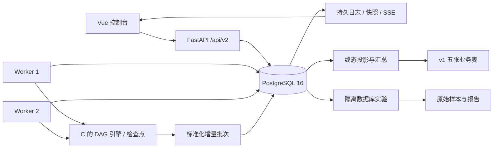

# v2 总体设计：研究生课程汇报与数据库实验平台

状态：设计基线，尚未实现。编制日期：2026-11-16，Asia/Shanghai。代码基线为 `13da2881965d8c30294870566496bff45c3bd91e`。本轮交付是设计、公共协议样例和开发任务，不代表 v2 功能已经完成。

## 1. 定位、依据与成功标准

项目名称：**基于 PostgreSQL 的 Agent 工作流执行、轨迹分析与数据库实验平台**。

v1 已验证五表建模、完整 Trace 原子持久化、分页检索、统计和两项索引实验；实际验收见 [12](12-v1-integration-verification.md)。当前短板是入口仍以单次模拟为主、只有固定 research 流程、树为缩进列表、耗时缺少可解释性、实验统计较少、没有持久化执行过程。

v2 要交付四条完整链路：

1. 创建并发布有版本的工作流 → 绑定 Agent → 排队、执行、取消或恢复 → 实时拓扑与历史回放。
2. 在拓扑中发现失败/长耗时 → 定位 Span 和事件 → 分析关键路径、重试和跨次运行差异。
3. 以隔离数据集运行数据库实验 → 保存原始样本和计划 → 比较性能、资源与正确性 → 导出报告。
4. 演示约束、事务竞争、MVCC、队列租约、增量聚合和故障恢复 → 用自动化测试与实测证据解释设计取舍。

研究生水平体现在问题、算法、数据库机制与可复现实验的结合，不以页面数或表数作为优秀标准。本文假定三名成员各投入约 4–6 周，另由负责人维护设计、审查和集成。没有时间信息时不把这一估计当作交付承诺。

文档优先级：v2 的 [14 数据模型](14-v2-database-design.md)、[15 接口与执行协议](15-v2-contracts.md)、[16 实验协议](16-v2-experiments.md)、[18 验收](18-v2-acceptance.md) 管理新增范围；现有 `/api/v1` 与五表字段仍服从 05/08。v2 不默默覆盖 v1 契约。无法由明确优先级解决的冲突提交负责人决策。

## 2. 必须完成的能力

| 编号 | 能力及可见结果 | A | B | C |
|---|---|---|---|---|
| V2-01 | 首屏为运行总览，含活跃运行、队列、近期失败、趋势、数据规模和直达示例 | 页面 | 查询 | 示例数据 |
| V2-02 | 工作流草稿编辑、DAG 校验、不可变版本发布、版本查看和复制 | 编辑器 | 存储/API | 语义校验 |
| V2-03 | 三种不同语义的场景，支持顺序、并行汇合、条件分支、节点重试 | 配置 | 调度 | 引擎 |
| V2-04 | PostgreSQL 持久化队列，两个 Worker 竞争领取、租约续期、旧 Worker 写入隔离 | 队列视图 | 实现 | 故障驱动 |
| V2-05 | 增量执行记录、断线续传、取消与崩溃恢复；已提交步骤不重复执行 | 展示/重连 | 日志与事务 | 检查点/恢复 |
| V2-06 | 真正的节点连线图，缩放/定位/折叠、实时状态、失败路径、选中详情 | 实现 | 快照/SSE | 节点身份 |
| V2-07 | 带时间刻度的瀑布图、并行区间、运行回放、按事件序号定位 | 实现 | 日志读取 | 正确时间 |
| V2-08 | 依赖关键路径、自耗时、重试代价、等待时间和解释性瓶颈定位 | 展示 | 数据/API | 算法 |
| V2-09 | 同版本 2–5 次运行的节点对齐、耗时/Token/失败/重试比较 | 展示 | 查询/API | 对齐/差异 |
| V2-10 | 全局检索、组合过滤、游标分页、Span 属性和文本搜索、保存筛选链接 | 实现 | SQL/索引 | 检索样本 |
| V2-11 | 实时指标与历史日聚合、显式数据水位和刷新时间、精确查询核对 | 展示 | 视图/MV | 对账工具 |
| V2-12 | 六类数据库实验：索引、JSONB、分页、聚合、MVCC、队列竞争 | 实验工作台 | 数据库实验 | 负载/验证 |
| V2-13 | 10万/100万 Span 标准数据、倾斜与失败分布、可复现实验清单 | 导入入口 | 数据登记 | 生成器 |
| V2-14 | 事务完整性演示、取消/恢复/发布等操作审计、数据库设计浏览 | 展示 | 实现 | 故障与校验 |
| V2-15 | 结果、原始样本、计划、环境、图表和报告导出，12分钟答辩路径 | 展示/下载 | 数据导出 | 评测报告 |
| V2-16 | 保留 v1、迁移兼容、独立模块测试和真实三方联调、性能与视觉验收 | 自有测试 | 自有测试 | 自有测试 |

上表全部是正式 v2 范围，不能将其中难项临时标成“后续优化”后宣称完成。进度不足时负责人必须明确批准变更范围并在发布记录中列出差异。

## 3. 页面与用户主线

主导航调整为：总览、工作流、运行中心、轨迹分析、日志检索、运行对比、数据库实验、数据与设计。Agent 管理和原型快速执行作为辅助入口保留。

- **总览**：终态成功率、P50/P95、Token、排队与执行时长、运行中任务、异常摘要；可直接打开成功、失败恢复、并行、取消四个示例。数据源及统计窗口明确可见。
- **工作流**：图与表单双视图；增删节点、连边、选择合法节点类型、编辑参数、绑定角色；发布时展示环、孤立节点、非法分支等错误。发布后的版本只读，通过复制生成草稿。
- **运行中心**：队列状态与业务状态分别显示，过滤/分页；启动、取消、重试为新 Run。点击后立即打开该 Run，不要求手工复制 UUID。
- **轨迹分析**：首屏为图、执行摘要和详情抽屉；瀑布图/事件/回放为标签页。50节点图适配视口，500 Span 不创建六千像素长页面。提供键盘选择和表格替代视图。
- **对比**：按逻辑 node_key 对齐，分别显示节点多次尝试；同版本严格比较，不把不同分支缺失节点视为0耗时。跨版本只提供定义差异，不作严格性能排名。
- **实验工作台**：问题、数据、变量、运行状态、原始样本、计划树、结果曲线和结论边界同页可达；显示测试库、规模与环境指纹，不显示凭据。
- **数据与设计**：ER图、表/约束/索引说明、允许公开的SQL模板、数据集清单、聚合刷新信息与审计。查询数据库目录和服务端白名单，不开放任意 SQL 控制台。

## 4. 执行与数据架构

- 保持 Python 3.11、PostgreSQL 16、Vue 3、Node 22，不为“高级”而引入 Kafka、Redis、微服务集群。
- API 与 Worker 分进程；v2 至少验证1个API、2个Worker。v1 旧 BackgroundTasks 保持单API进程限制，不能借 v2 宣称整个系统任意多实例安全。
- v2 Run 同时拥有 `runs` 业务身份和 `run_executions` 执行元数据。`run_journal` 是已提交执行过程的持久事实；检查点与该批日志同事务提交。
- 实时节点状态来自日志投影；终态时完整校验并将闭合 Span/Event、依赖边、汇总、终态日志一次提交。v1查询只读取原五表，不读半个完成结果。
- API重启不能把v2运行全部改FAILED；原启动恢复仅处理没有 `run_executions` 的旧v1 Run。这个迁移点必须单独测试。
- 不宣称外部调用 exactly-once。v2必做执行器均为无副作用的确定性模拟；恢复保证只跳过已确认提交的节点，未确认调用允许重试并记录尝试。

## 5. 三种场景及执行语义

| 场景 | 结构与行为 | 用于回答的问题 |
|---|---|---|
| RESEARCH_PIPELINE | 研究、分析、审查；检索与模型步骤；可恢复失败 | 重试是否提高成功率、代价是什么 |
| PARALLEL_RETRIEVAL | 2–4路并行检索 → 合并 → 生成 → 校验 | 并行后的墙钟耗时、重叠执行和关键路径如何变化 |
| QUALITY_GATE | 生成 → 质量判断 → 通过/回退分支 → 汇合 | 条件路由、跳过节点、失败传播和可解释性 |

执行图为有限 DAG；不提供循环、任意Python代码、用户SQL或无限自主Agent。允许的节点类型为 START、END、LLM、TOOL、RETRIEVAL、MERGE、CONDITION；AGENT是按角色生成的归属容器，不混作DAG中的调度步骤。条件只引用预定义结果标签，不执行表达式字符串。

一个工作流最多50节点、100依赖边、8个角色；每个Run最多500 Span、2000 Span Event、5000条journal记录、60秒配置的模拟执行预算；排队最长300秒、单Run含恢复的墙钟上限600秒。实时演示单步骤100–1500ms，批量生成用虚拟时钟。预算在启动前校验，并在执行中再次约束。不能通过递归重试突破上限。

Containment树与依赖DAG分开：`parent_span_id` 表示归属；`span_links` 表示先后、汇合、重试。禁止把并行分支误画成父子相互调用。节点由 node_key 稳定识别，尝试由 attempt_no 区分。

## 6. 研究问题与结论边界

必须完成三条主要实证问题，另有机制实验佐证：

1. **索引与选择率**：组合/部分/GIN索引在不同规模和倾斜分布下，何时收益超过写入和空间代价？
2. **交互查询与聚合**：游标分页及预聚合能否改善深页和宽时间窗口，代价与一致性边界是什么？
3. **执行一致性**：在并行Worker、连接中断、重复批次和租约失效下，能否保证唯一终态、完整投影及可恢复进度？

工作流算法必须提供拓扑排序、循环检测、并行调度、检查点恢复、DAG关键路径和区间并集自耗时；给出复杂度、适用假设和反例。异常提示采用透明阈值/稳健统计，不包装成未经验证的AI根因定位。

真实模型接入、标准OTLP协议、账户RBAC、HuaDB内核修改、跨地域分布式部署不是本轮必做。真实模型可作为独立扩展，但不成为课程验收依赖，不在本轮配置密钥或产生外部调用。禁止用模拟Token、虚拟时间和隔离表实验推断模型效果或生产吞吐量。

## 7. 交付组织

成员分工及可复制Prompt见 [17](17-v2-member-prompts.md)。负责人先冻结本轮文档、JSON Schema及联动样例；三人从同一代码基线独立开发。A使用样例与显式mock，B用固定协议数据及真实PostgreSQL，C用内存Sink与标准库测试服务，不等待其他成员实现。

建议六个里程碑：协议冻结 → 独立骨架 → 功能闭环 → 真机集成 → 实验与故障 → 答辩冻结。每阶段都有退出标准；最后两阶段预留约30%工作量。复杂度和完整性通过提前设计、持续验收控制，不能承诺一次设计消除所有实现迭代。

阅读顺序：本文 → [14](14-v2-database-design.md) → [15](15-v2-contracts.md) → [16](16-v2-experiments.md) → [17](17-v2-member-prompts.md) → [18](18-v2-acceptance.md)。
