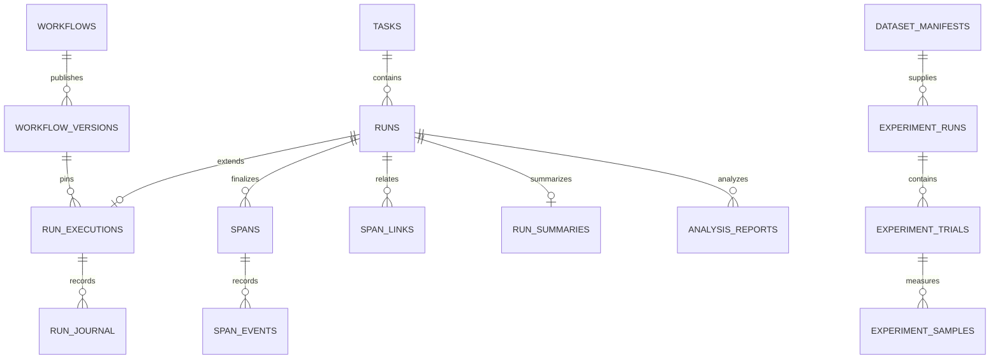

# v2 数据模型、约束与事务设计

状态：设计，SQL尚未应用。依据 [13](13-v2-overall-design.md)；协议见 [15](15-v2-contracts.md)。B负责实现迁移和数据访问，负责人审查；本文授权的新增设计不等于可以改写已经应用的001。

## 1. 演进原则与表的职责

保留 agents、tasks、runs、spans、span_events 的字段与v1响应。新增表不把所有关系藏进JSONB：身份、状态、顺序、外键、时间、租约、查询维度使用关系列；工作流定义、执行检查点、计划和报告使用受版本约束的JSONB。

| 新对象 | 职责 / 为什么需要 |
|---|---|
| workflows | 可编辑草稿、名称、描述、乐观锁版本 |
| workflow_versions | 发布后不可变的定义、角色与定义哈希 |
| run_executions | 绑定版本、运行配置、队列状态、租约、检查点和运行时间 |
| run_journal | 实时执行事实、幂等标识、重放与SSE游标 |
| span_links | containment树以外的依赖、重试和交接关系 |
| run_summaries | 终态派生汇总，避免每次扫Span；不可作为另一套原始事实 |
| analysis_reports | 带算法版本和输入水位的分析结果缓存 |
| request_keys | 创建运行/实验的请求幂等，不用内存锁冒充跨进程保证 |
| dataset_manifests | 生成参数、实际计数、内容摘要和可复现信息 |
| experiment_runs | 异步实验任务、环境、配置和终态 |
| experiment_trials | 每个实验方案/规模/选择率的一组试验 |
| experiment_samples | 各次原始测量、完整计划、行数、缓冲区和资源指标 |
| audit_log | 发布、取消、恢复、刷新聚合、实验操作的追加审计 |
| v_run_facts / mv_daily_metrics | 统一查询视图 / 有水位的日物化聚合 |

工作流身份、发布版本、执行事实、派生统计和实验样本分层，是规范化与可维护性的依据。派生汇总属于有重建方法的受控冗余，不声称全库无冗余。



## 2. 新增DDL的冻结骨架

以下是字段、主外键、状态及唯一性规范；B须将完整迁移写入新文件、补足下面说明的触发器/索引/视图，不能仅复制骨架后宣称完成。均在public schema，UUID使用已有gen_random_uuid。JSONB列均须验证预期的object/array类型；跨行DAG和协议检查由服务层完成，不用CHECK假装验证完整图。

```sql
CREATE TABLE workflows (
  workflow_id uuid PRIMARY KEY DEFAULT gen_random_uuid(),
  name varchar(100) NOT NULL CHECK (length(btrim(name)) > 0),
  description text,
  draft jsonb NOT NULL CHECK (jsonb_typeof(draft) = 'object'),
  revision integer NOT NULL DEFAULT 1 CHECK (revision > 0),
  archived_at timestamptz,
  created_at timestamptz NOT NULL DEFAULT now(),
  updated_at timestamptz NOT NULL DEFAULT now()
);
CREATE TABLE workflow_versions (
  version_id uuid PRIMARY KEY DEFAULT gen_random_uuid(),
  workflow_id uuid NOT NULL REFERENCES workflows,
  version_no integer NOT NULL CHECK (version_no > 0),
  definition jsonb NOT NULL CHECK (jsonb_typeof(definition) = 'object'),
  definition_hash char(64) NOT NULL CHECK (definition_hash ~ '^[0-9a-f]{64}$'),
  created_at timestamptz NOT NULL DEFAULT now(),
  UNIQUE(workflow_id, version_no)
);
CREATE TABLE run_executions (
  run_id uuid PRIMARY KEY REFERENCES runs ON DELETE RESTRICT,
  version_id uuid NOT NULL REFERENCES workflow_versions,
  config jsonb NOT NULL CHECK (jsonb_typeof(config) = 'object'),
  agent_bindings jsonb NOT NULL CHECK (jsonb_typeof(agent_bindings) = 'object'),
  execution_state varchar(16) NOT NULL DEFAULT 'QUEUED'
    CHECK (execution_state IN ('QUEUED','RUNNING','RECOVERING','FINALIZING','FINISHED')),
  priority smallint NOT NULL DEFAULT 0 CHECK (priority BETWEEN -10 AND 10),
  queued_at timestamptz NOT NULL DEFAULT now(),
  execution_started_at timestamptz,
  execution_ended_at timestamptz,
  deadline_at timestamptz NOT NULL,
  worker_id varchar(100),
  lease_epoch bigint NOT NULL DEFAULT 0 CHECK (lease_epoch >= 0),
  lease_expires_at timestamptz,
  heartbeat_at timestamptz,
  recovery_count integer NOT NULL DEFAULT 0 CHECK (recovery_count BETWEEN 0 AND 2),
  cancel_requested_at timestamptz,
  last_seq bigint NOT NULL DEFAULT 0 CHECK (last_seq >= 0),
  checkpoint jsonb NOT NULL DEFAULT '{}' CHECK (jsonb_typeof(checkpoint) = 'object'),
  retry_of_run_id uuid REFERENCES runs,
  CHECK (retry_of_run_id IS NULL OR retry_of_run_id <> run_id),
  CHECK (execution_ended_at IS NULL OR execution_ended_at >= execution_started_at),
  CHECK ((worker_id IS NULL) = (lease_expires_at IS NULL))
);
CREATE TABLE run_journal (
  run_id uuid NOT NULL REFERENCES run_executions,
  seq bigint NOT NULL CHECK (seq > 0),
  batch_id uuid NOT NULL,
  batch_hash char(64) NOT NULL CHECK (batch_hash ~ '^[0-9a-f]{64}$'),
  producer_event_id uuid NOT NULL,
  kind varchar(40) NOT NULL,
  payload jsonb NOT NULL CHECK (jsonb_typeof(payload) = 'object'),
  payload_hash char(64) NOT NULL CHECK (payload_hash ~ '^[0-9a-f]{64}$'),
  lease_epoch bigint NOT NULL CHECK (lease_epoch >= 0),
  occurred_at timestamptz NOT NULL,
  recorded_at timestamptz NOT NULL DEFAULT clock_timestamp(),
  PRIMARY KEY(run_id, seq), UNIQUE(run_id, producer_event_id)
);
CREATE TABLE span_links (
  run_id uuid NOT NULL REFERENCES runs,
  source_span_id varchar(16) NOT NULL,
  target_span_id varchar(16) NOT NULL,
  link_type varchar(16) NOT NULL CHECK (link_type IN ('DEPENDS_ON','RETRY_OF','HANDOFF')),
  PRIMARY KEY(run_id, source_span_id, target_span_id, link_type),
  FOREIGN KEY(run_id,source_span_id) REFERENCES spans(run_id,span_id)
    DEFERRABLE INITIALLY DEFERRED,
  FOREIGN KEY(run_id,target_span_id) REFERENCES spans(run_id,span_id)
    DEFERRABLE INITIALLY DEFERRED,
  CHECK (source_span_id <> target_span_id)
);
CREATE TABLE run_summaries (
  run_id uuid PRIMARY KEY REFERENCES runs,
  summary_seq bigint GENERATED ALWAYS AS IDENTITY UNIQUE,
  finalized_at timestamptz NOT NULL,
  run_started_at timestamptz NOT NULL,
  final_status varchar(12) NOT NULL CHECK (final_status IN ('SUCCESS','FAILED','CANCELLED')),
  execution_mode varchar(16) NOT NULL CHECK (execution_mode IN ('LEGACY','REALTIME','VIRTUAL')),
  span_count integer NOT NULL CHECK (span_count BETWEEN 0 AND 500),
  event_count integer NOT NULL CHECK (event_count BETWEEN 0 AND 2000),
  error_count integer NOT NULL CHECK (error_count >= 0 AND error_count <= span_count),
  input_tokens bigint NOT NULL CHECK (input_tokens >= 0),
  output_tokens bigint NOT NULL CHECK (output_tokens >= 0),
  wall_duration_ms double precision NOT NULL CHECK (wall_duration_ms >= 0),
  queue_duration_ms double precision,
  execution_duration_ms double precision,
  logical_duration_ms double precision,
  journal_seq bigint,
  CHECK (queue_duration_ms IS NULL OR queue_duration_ms >= 0),
  CHECK (execution_duration_ms IS NULL OR execution_duration_ms >= 0),
  CHECK (logical_duration_ms IS NULL OR logical_duration_ms >= 0)
);
CREATE TABLE analysis_reports (
  report_id uuid PRIMARY KEY DEFAULT gen_random_uuid(),
  run_id uuid NOT NULL REFERENCES runs,
  journal_seq bigint NOT NULL CHECK (journal_seq >= 0),
  algorithm_version varchar(40) NOT NULL,
  report jsonb NOT NULL CHECK (jsonb_typeof(report) = 'object'),
  created_at timestamptz NOT NULL DEFAULT now(),
  UNIQUE(run_id,journal_seq,algorithm_version)
);
CREATE TABLE request_keys (
  scope varchar(200) NOT NULL, key varchar(100) NOT NULL,
  request_hash char(64) NOT NULL CHECK (request_hash ~ '^[0-9a-f]{64}$'),
  resource_id uuid NOT NULL,
  response_status smallint NOT NULL CHECK (response_status IN (201,202)),
  response_body jsonb NOT NULL CHECK (jsonb_typeof(response_body) = 'object'),
  created_at timestamptz NOT NULL DEFAULT now(),
  PRIMARY KEY(scope,key)
);
CREATE TABLE dataset_manifests (
  dataset_id uuid PRIMARY KEY DEFAULT gen_random_uuid(),
  name varchar(100) NOT NULL,
  purpose varchar(20) NOT NULL CHECK (purpose IN ('DEMO','BENCHMARK','LOAD')),
  state varchar(16) NOT NULL CHECK (state IN ('BUILDING','READY','FAILED')),
  seed bigint NOT NULL,
  config jsonb NOT NULL CHECK (jsonb_typeof(config) = 'object'),
  actual_counts jsonb NOT NULL CHECK (jsonb_typeof(actual_counts) = 'object'),
  content_hash char(64),
  generator_version varchar(80) NOT NULL,
  created_at timestamptz NOT NULL DEFAULT now(),
  completed_at timestamptz,
  CHECK (content_hash IS NULL OR content_hash ~ '^[0-9a-f]{64}$')
);
CREATE TABLE experiment_runs (
  experiment_id uuid PRIMARY KEY DEFAULT gen_random_uuid(),
  dataset_id uuid NOT NULL REFERENCES dataset_manifests,
  case_code varchar(40) NOT NULL,
  status varchar(16) NOT NULL CHECK (status IN ('QUEUED','RUNNING','SUCCESS','FAILED','CANCELLED')),
  phase varchar(16) CHECK (phase IN ('PREPARING','WARMUP','MEASURING','VERIFYING','EXPORTING')),
  progress double precision CHECK (progress BETWEEN 0 AND 1),
  cancel_requested_at timestamptz,
  runner_id varchar(100),
  config jsonb NOT NULL CHECK (jsonb_typeof(config) = 'object'),
  environment jsonb NOT NULL CHECK (jsonb_typeof(environment) = 'object'),
  protocol_version varchar(40) NOT NULL,
  code_revision varchar(80) NOT NULL,
  created_at timestamptz NOT NULL DEFAULT now(),
  started_at timestamptz,
  ended_at timestamptz,
  error_code varchar(80)
);
CREATE TABLE experiment_trials (
  trial_id uuid PRIMARY KEY DEFAULT gen_random_uuid(),
  experiment_id uuid NOT NULL REFERENCES experiment_runs,
  ordinal integer NOT NULL CHECK (ordinal > 0),
  variant varchar(80) NOT NULL,
  parameters jsonb NOT NULL CHECK (jsonb_typeof(parameters) = 'object'),
  summary jsonb NOT NULL CHECK (jsonb_typeof(summary) = 'object'),
  UNIQUE(experiment_id,ordinal)
);
CREATE TABLE experiment_samples (
  trial_id uuid NOT NULL REFERENCES experiment_trials,
  repetition integer NOT NULL CHECK (repetition >= 0),
  is_warmup boolean NOT NULL,
  measured_at timestamptz NOT NULL,
  metrics jsonb NOT NULL CHECK (jsonb_typeof(metrics) = 'object'),
  plan jsonb,
  correctness jsonb NOT NULL CHECK (jsonb_typeof(correctness) = 'object'),
  PRIMARY KEY(trial_id,repetition),
  CHECK (plan IS NULL OR jsonb_typeof(plan) = 'object')
);
CREATE TABLE audit_log (
  audit_id bigint GENERATED ALWAYS AS IDENTITY PRIMARY KEY,
  action varchar(80) NOT NULL,
  resource_type varchar(40) NOT NULL,
  resource_id uuid,
  actor varchar(100) NOT NULL,
  request_id uuid NOT NULL,
  details jsonb NOT NULL CHECK (jsonb_typeof(details) = 'object'),
  occurred_at timestamptz NOT NULL DEFAULT clock_timestamp()
);
```

物理DDL还必须做到：

- 已发布版本禁止UPDATE/DELETE，audit_log禁止UPDATE/DELETE：使用拒绝修改的触发器；迁移/运维清理走显式专用过程或受控DDL，不在应用API开放。`actor`来自LOCAL_OPERATOR或WORKER身份，是操作来源记录，不冒充认证用户。
- 草稿UPDATE按 `WHERE revision=:expected`，成功原子增加revision和updated_at；发布锁workflows行，服务端分配version_no、校验定义并计算哈希，与审计同事务提交。
- agent_bindings 的角色键属于该版本roles、全部Agent存在且启动时ACTIVE；JSON值不具有数据库外键，B须持Agent共享行锁验证后保存身份快照，Agent仍不允许删除。
- execution_state与runs.status跨表一致性通过同一事务维护，测试不能只看单表CHECK。FINISHED必须对应Run终态；非FINISHED必须对应RUNNING。FINISHED清空租约。
- run_journal.kind只允许15定义的枚举。batch_id用于整批重试；batch_hash覆盖该批生产者事件的顺序/内容、checkpoint和terminal语义（排除15明确的传输字段），随每行保存，供旧批次重放校验。重复批须包含相同event_id集合、顺序和内容，检查点重复时也须相同；不能靠冲突忽略掩盖不同内容。
- double precision输入仅接受有限数，不能让NaN/Infinity通过HTTP或JSONB；字节大小、计数和文本长度在API入口与内部写入边界双重验证。

## 3. 索引与查询职责

| 对象 | 必须的索引/约束 | 目标与代价 |
|---|---|---|
| workflow_versions | 已有(workflow_id,version_no)唯一索引 | 稳定版本序号，发布竞争 |
| run_executions | (priority DESC,queued_at,run_id) WHERE state='QUEUED' | SKIP LOCKED领取；优先级可能饿死，见老化规则 |
| run_executions | (lease_expires_at,run_id) WHERE state IN ('RUNNING','RECOVERING','FINALIZING') | 扫描失效租约 |
| run_executions | (version_id,queued_at DESC,run_id) | 同版本对比与历史 |
| run_journal | 主键(run_id,seq)、唯一(run_id,producer_event_id)、(run_id,batch_id,seq) | SSE与幂等检查，追加成本需测量 |
| span_links | (run_id,target_span_id) | 反向依赖定位 |
| span_events | (occurred_at DESC,event_id DESC) | 全局游标，代价为新增索引写放大 |
| spans | GIN(attributes jsonb_path_ops)，SQL限定使用 @> | 属性检索；选择率较高不保证走GIN |
| spans | GIN(to_tsvector('simple',coalesce(error_message,''))) | 错误文本搜索；simple不承诺中文分词效果 |
| run_summaries | (run_started_at,run_id)、summary_seq唯一 | 时间窗口与刷新水位 |
| experiment_runs | (created_at DESC,experiment_id DESC) | 历史分页 |
| audit_log | (occurred_at DESC,audit_id DESC)、(resource_type,resource_id,audit_id) | 资源历史和时间检索 |

不为每个可筛选字段单独建索引。B须用固定查询负载给出候选索引选择依据、未采用项及空间/写入开销；最终优化结论来自16实验。

`v_run_facts` 一行一Run：从runs、run_executions、run_summaries连接，运行中计数不能依赖终态汇总。`mv_daily_metrics` 按UTC日期、execution_mode、version_id（旧v1可null）分组，保存成功/失败/取消计数、耗时count/sum、Token与Span合计、输入最大summary_seq和snapshot_at；**不对日P95再取平均**。任意窗口P50/P95从run_summaries原始耗时算，MV只加速可结合的计数/和/平均。

首次CREATE/首次普通REFRESH后建立分组键唯一索引（PG16使用NULLS NOT DISTINCT或显式非空分组编码），以后REFRESH MATERIALIZED VIEW CONCURRENTLY。刷新水位和内容来自同一MV快照；`max(summary_seq)`只能代表该次快照可见的最大序号，不能推断所有小于该值的事务都已提交。精确核对使用刷新时REPEATABLE READ快照/已冻结数据集，不用max值充当连续提交日志。

## 4. 核心事务与锁顺序

所有路径统一先锁run_executions、再runs；v1只锁runs。不能在调用模拟器、等待网络或sleep期间持数据库事务。

1. **启动**：请求幂等键竞争 → 校验Task/版本/Agent → 创建runs、run_executions和首条run.queued日志 → request_keys记录完整202响应 → 审计 → COMMIT。冲突相同hash返回原响应，不同hash409；事务回滚不留半个键。scope=`v2:tasks:{task_id}:runs`，键至少保留到该资源显式归档，v2不自动TTL删除。
2. **领取**：短事务 `FOR UPDATE SKIP LOCKED` 选择QUEUED行 → epoch+1 → 设置owner/expiry/started_at、RUNNING → 追加run.started → COMMIT。默认优先级0；每轮先处理等待超过30秒的最老Run，再按priority领取，防止永久饥饿。
3. **增量提交**：锁execution → 查询该batch_id已提交收据（由journal分组及batch_hash重建） → 已存在同语义返回原ACK、不同语义409 → 新批次才校验owner、epoch、未过期、expected_last_seq → 为连续批次分配seq → 插入journal → 更新checkpoint、last_seq → COMMIT。同批返回ACK是只读幂等结果，即使租约已清空/终态也允许，不授权旧epoch新写入。seq在同一Run内连续；不使用全库sequence声称事务无缺口。至多100条/批，提交间隔不超过250ms或一个节点边界。
4. **续租/恢复**：lease默认15秒、heartbeat每5秒，使用数据库clock_timestamp判断有效性。失效恢复者锁行、epoch+1，旧Worker所有写入409；C将旧在途尝试闭合WorkerLost并从已提交检查点恢复，最多2次恢复。deadline从初次排队开始不重置。无副作用模拟器的恢复语义见15。
5. **取消**：仅对非终态设置cancel_requested_at、追加cancel.requested、写审计。取消QUEUED可由B直接以零Span收尾；运行中C在步骤等待/提交点响应、闭合已有Span并返回CANCELLED。完成/取消争用同一行锁，最先提交终态的一方胜出，不能事后改终态。
6. **完成投影**：B在锁和有效租约内确认期望水位，调用C纯reducer获得闭合结果；校验树、链接、预算 → spans、events、links、summary → runs终态和ended_at → run.finished journal、execution FINISHED/最后检查点 → COMMIT。`run.finished`带最终水位；相同已提交完成批次返回原ACK，其他完成请求409。中途失败整笔回滚。
7. **恢复耗尽**：B使用C的seal_interrupted投影已提交事实，根与未闭合Span标ERROR/WorkerLost，终态FAILED。不能生成虚假的成功步骤；完全未开始允许零Span。若投影不可用，保留journal、标基础设施FAILED并写审计及零Span汇总，界面明确“轨迹不完整”。

v2允许CANCELLED由新完成服务提交，旧SimulationResult与旧complete_run签名不变。实时日志与终态投影为不同表的有意分层；对账器须保证终态日志可重放为相同规范结果。

terminal批次由B追加的run.finished使用同一个batch_id/batch_hash，ACK的first/last_seq取整组min/max，terminal_committed由组内run.finished判定；组内额外系统事件不能被当作C原始events参与重放比较。没有提交的batch不会产生收据。不同batch复用已存在producer_event_id直接409，不把部分去重误当整批成功。

Worker同时承担短周期sweeper：QUEUED超过300秒以FAILED/QueueTimeout收尾，含排队的deadline_at为queued_at+600秒；RUNNING/RECOVERING/FINALIZING超过deadline，使用持有新epoch的恢复收尾路径，不再重新执行。所有时钟比较取数据库时间；恢复心跳不能延长初始截止时间。C负责60秒逻辑预算与配置执行预算，B负责墙钟/排队/租约边界，两者不是同一个计时器。

## 5. 迁移与数据生命周期

- 建议002为新增结构、003为索引/触发器/视图、004为已完成v1 Run汇总回填。文件名由B统一占用，其他成员不创建数据库迁移。
- 001 checksum不变；空库、原型库、当前v1库均测试；数据库规模大时回填按run_id keyset分批可重试，单Run汇总唯一键防重复。回填期间v2精确查询对无汇总终态Run使用显式兼容分支，不悄悄漏计。
- v1完成路径在B负责范围内增加“同事务写LEGACY汇总”，保持旧响应和测试；否则新v1 Run会绕过v2统计。回填和实时双写必须对账。
- v1 benchmarks.json保留只读原路径，不静默迁移或清空。显式导入命令生成带legacy标识的实验记录；旧“三次中位数”不能伪造为v2的完整原始样本。
- 默认保留journal和实验样本；容量/表膨胀展示只读。清理工具支持dry-run、仅专用实验schema与dataset_id、显式确认精确目标；不删除开发业务数据。
- 本轮不强行把既有spans改分区表；若做分区对比，仅在实验schema克隆表，评估分区裁剪与唯一/外键约束代价，作为扩展证据。
- 应用数据库角色仅获得所需DML/序列权限；迁移角色负责DDL，实验角色仅访问隔离库。提供权限SQL和测试，不把角色权限等同于应用登录系统。

## 6. 必须提供的数据库证据

完整ER图、字段字典、函数依赖/3NF说明、受控冗余与重建SQL、查询及索引映射、实际EXPLAIN计划、MV快照语义、事务交错时间表、约束失败与回滚、死锁避免和租约fencing测试。schema_migrations属于技术表，不计为业务创新。
