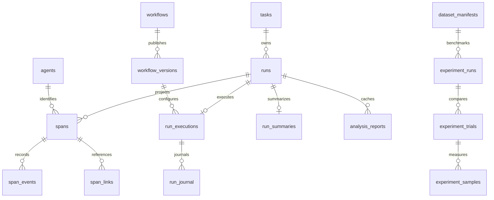

# 成员 B：V2 独立开发交付记录

状态：**B 的数据库、持久执行和实验基础设施已实现；整套 V2 尚未完成验收。** C 的真实引擎/分析和 A 的页面未合入本分支，公共接口仍有缺项。固定 C 替身不能证明三方真实集成通过。

## 基线与范围

- 共同基线 `19560b3`；本地分支 `codex/v2-backend`。
- 主实现提交 `2661da432221b7f9f525146f28bafbe2fe093f25`；最终代码提交 `ba86b4be9c6a93f5ad5ee47c9e6f563b391c11eb`（实时总览计数及 LiveSpan 边界修正）。下述大规模测量对应主实现提交，后续修正不涉及 Lab。
- 工作目录 `E:\sjk\agent-observability`；工具、依赖、缓存、数据库、证据均在 E 盘项目目录。
- 只修改 17 允许的 B 文件。前端、C 模块/脚本、根 fixture、旧公共模型、`contracts/v2/` 和负责人测试未改。
- 没有 push、PR、合并 main 或自动向负责人发消息。用户给定三小时上限，可提前交付。

## 实现与证据

| 工作包 | 实现及主要文件 | 已有证据 |
|---|---|---|
| 数据库 | 13 张新表、索引、版本/审计不可变、跨表终态约束、回填、事实视图/MV；`database/migrations/002`–`007` | 真实 PG 约束/回滚、旧库升级、重复迁移、001 checksum |
| 工作流 | revision/If-Match、JCS、发布/归档、绑定身份共享锁；`services/v2_workflows.py`、`v2_runs.py` | 并发幂等、过期 revision、历史不可变 |
| Worker | 独立入口、SKIP LOCKED、优先级/30 秒老化、租约/epoch、心跳、取消缓存、恢复预算/截止；`app/worker/` | 两个实际子进程、领取后进程死亡及接替 |
| Journal | 批次收据、ACK 重发、检查点/seq、身份/树/依赖 DAG 校验、五表/汇总原子终态；`v2_journal.py`、`v2_projection.py` | 旧 epoch 拒写、ACK 丢失、取消/完成竞争、FK 整笔回滚 |
| 查询 | 快照/SSE、游标/过滤哈希、JSONB/错误文本搜索、总览/Agent、MV、目录/审计；`api/v2*.py`、`v2_queries.py`、`v2_analytics.py` | 真实 HTTP 10 个 SSE、低连接占用、晚提交水位反例、刷新超时 |
| 共享适配 | 冻结 JSON Schema/JCS、执行/投影模型、输入边界；`contracts/v2/`、`schemas/v2*.py` | 冻结样例、OpenAPI、39 个登记路径 |
| Lab | 物理隔离库、UUID schema、独立进程/session 锁、队列、取消/超时、原始样本/完整计划/导出；`app/lab/`、`services/v2_lab.py` | 查询实验、1000 作业对照、跨进程互斥、40001/57014 |
| V1 | 恢复排除 V2、同事务 LEGACY 汇总、旧实验 JSON/接口保留；`repositories/execution.py`、`services/run_completion.py`、`services/benchmarks.py` | 249 项旧检查通过，1 项过时断言保留 |

路由登记不是全部启用。能力接口中的 `workflow_editor/durable_queue/live_graph/experiments` 仍为 false；独立完成的检索、聚合、目录、审计单独为 true。完成 C 对接和下述缺项后由负责人启用完整功能。

## 数据模型、一致性与索引



关系层按实体拆分、主键决定本行属性。版本候选键为 `(workflow_id, version_no)`，样本为 `(trial_id, repetition)`。不声称 JSON 文档本身满足关系数据库 3NF。`request_keys` 和 `audit_log` 使用 scope/resource_type 区分多种资源，不能伪装为单表外键；Span Link 两端为复合外键。

受控冗余是配置/角色 UUID 快照、journal/hash、checkpoint、summary、analysis cache、MV。版本冻结定义并算 JCS SHA256，Agent 接受时以共享锁验证 ACTIVE。B 只替换检查点的服务器水位；终态与汇总同事务；分析缓存带水位/算法版本，MV可重建。

锁顺序始终 execution→run。已提交相同批次先返回原 ACK，即使旧租约已结束；新写入才校验 owner/epoch/期限。纯 reducer 返回后再次验证时间，持锁不等于延长租约。控制事件推动 seq 时，Sink 只重基同一批业务事件，不重跑步骤。

运行中计数来自持久事实而非仅终态汇总；最终快照使用已提交规范结果。不完整收尾保留标志，失败不一律显示逻辑节点 100% 完成。恢复封口的完整 journal 重放仍是下述未验收项。

MV 的 stale 用源汇总与 MV 内容双向差集检查，不能只比 max(summary_seq)。两事务“小序号晚提交”的反例已经验证。P50/P95 从逐 Run 耗时计算，不平均日 P95。时间区分 LEGACY/REALTIME/VIRTUAL、队列和执行。

索引按查询映射设置：排队/租约过期、版本历史、batch 收据、事件游标、JSONB @>、simple 错误全文、summary 时间、审计/实验历史；007 为全局 Span `(start_time DESC,span_pk DESC)` 游标。没有逐字段无差别建索引，候选索引收益由真实计划说明；simple 不承诺中文分词。

## 迁移与权限

- 001 原文未变；002 新表，003 索引/触发器/视图，004 LEGACY 回填，005 受限 MV 刷新函数，006 实时事实/实验终态约束，007 Span 游标索引。
- 用本次随机命名的独立数据库先装 001、写旧 Run/Span，再升级两次；原行摘要、001 checksum、summary 数量核对通过，仅删除本次创建的库。开发库没有执行 V2 迁移或清数据。
- 回填按 run_id 分段并幂等插入；整个迁移仍是单事务，不宣称大库在线零阻塞升级。
- `database/roles.sql`：`observability_app` 只有所需 DML/序列权限。PG16 刷新 MV 通过固定 SQL、固定 search_path 的 SECURITY DEFINER 函数；撤销 PUBLIC 执行权。
- `database/lab_roles.sql`：实验权限组仅访问隔离库，可建自己的 schema/临时表，不能在 public 建表。角色是 NOLOGIN 权限组，不是登录系统。部署者需另配非超级用户登录角色。
- 权限测试用 SET ROLE/连接启动 role 验证 42501，并以应用角色完成终态提交；不等于生产账号已配置。
- `python -m app.lab.bootstrap` 由迁移所有者执行，在隔离库安装空的冻结 001 模板及 checksum。旧实验可在该库创建原有 pg_temp 表，保留 JSON 路径/响应；最小权限部署若启用旧实验，须配置 EXPERIMENT_DATABASE_URL，不能给业务角色补业务 DDL 权限。
- 实验数据仅在服务端 UUID schema。cleanup 默认 dry-run，确认后也仅删除精确 UUID schema，不清理开发库/public。

## 检查结果与复现命令

实际环境：本地 PostgreSQL 16、Python 3.11；业务测试库 `agent_observability_v2_test`，物理独立的 `agent_observability_v2_lab`。新增测试仅在 `backend/tests/backend_v2/`，原入口不变。

```text
python scripts/test_backend.py tests/backend_v2 -k "not queue_experiment" -x --tb=short
49 passed，1 deselected，19.17 秒。

python scripts/test_backend.py tests/backend_v2/test_lab.py -k "fault or process or queue_experiment" -x --tb=short
4 passed；包含 1000 作业、2 领取者、两策略、3 预热+15 正式轮。
该长队列负载已通过，不在每次修改后重复执行。

python scripts/test_backend.py tests/backend_v2/test_journal.py -x --tb=short
7 passed；最后确认 B 只修改 checkpoint.journal_seq。

python scripts/test_backend.py tests/backend_v2/test_contracts.py tests/backend_v2/test_queries.py -x --tb=short
11 passed，1.56 秒；最终代码 ba86b4b 的增量检查，含新增的实时总览和 LiveSpan 约束案例。
本轮不同 B 用例共 52 项通过；以上重叠执行不重复计数。

python scripts/test_backend.py tests --ignore=tests/backend_v2 -x --tb=short
217 passed 后被旧迁移数量断言中断。

python scripts/test_backend.py tests/test_database.py tests/test_recorder.py tests/test_shared_contracts.py -k "not test_migrations_repeat_without_changing_schema" --tb=short
余下 32 passed、1 deselected。合计旧版 249 通过，1 项明确保留的过时断言失败。

ruff check backend/app backend/tests/backend_v2
All checks passed。
git diff --check
通过。
```

Starlette/AnyIO 有一条弃用警告。没有用 skip、SQLite 或 mock SQL 替代数据库证据。

真实子进程测试：两个 Worker 执行生产 Worker/Sink/SQL，领取屏障后只结束本次登记的进程并让新进程接替；Uvicorn 下 10 个 SSE 补齐序号，API 连接不超过 4，没有订阅长期持有 idle-in-transaction。CORS 做了真实 HTTP 预检，未宣称浏览器跨源全站验收。

故障包括 ACK 丢失、旧 epoch、身份伪造/依赖环、取消与完成竞争、FK 回滚、MV 阻塞超时、Lab 取消/SQL 超时保留样本、两个 Lab 进程互斥及前任消失恢复。短故障预算用于触发真实 SQLSTATE；正式 MV/实验 SQL 预算仍为 10 秒/30 秒。

MVCC 用 B 的受控操作与明确屏障，验证 RC/RR 可见性、RR 写偏斜、SERIALIZABLE 40001，以及重试重新读取后保留至少一条 active；不是 C 的正式矩阵驱动。

C 替身仅为冻结定义/JournalBatch/投影/分析输出。`worker_probe.py` 在测试子进程内挂载固定输出并重映射 fixture ID，不实现第二套 DAG/调度/重试/时钟。正式服务不会加载测试替身。

## 实验证据与限制

本地原始证据：`backend/var/v2-evidence/`，测量代码 `2661da4`，大型产物忽略提交。共 14 份实验 JSON、648 条原始样本记录（含预热和 N/A），`evidence-manifest.json` 记录各文件 SHA256、大小和样本数；另有 `100k-tests.log`、`1m-tests.log`。

数据为 B 自建完整约束夹具：每 Run 500 Span、单根/合法父子和 Agent 引用、8 Agent、90 天、10% ERROR、region 1%/99%，属性 PostgreSQL JSON 文本 128 字节。数量、单根、字节数由 SQL 验证。**不是 C 的标准生成器或 DEMO/LOAD。** 测试直接置 READY 以检查实验服务，明确记录 `B-test-only-unverified-manifest` 且 content_hash=null，没有冒充 Loader/finalize 校验。

100K：7 组查询实验通过，94.67 秒；1M：同样 7 组通过，379.08 秒。组合为 TRACE、ERROR、JSONB、分页 rank 0/10000/100000、90 天聚合。每方案 3 次预热+15 正式轮，seed=42 随机化配对顺序。100K 下 rank=100000 明确 N/A，时间为 null，不当作 0ms 或失败。剔除预热和 N/A 后，100K 有 240 条、1M 有 270 条正式计时样本。

实测客户端耗时中位数，单位 ms（包含读取与结果哈希，不能冒充 SQL 引擎时间）：

| 查询与方案 | 100K | 1M |
|---|---:|---:|
| TRACE：保留基础索引 / 新增复合候选 | 3.264 / 3.421 | 3.399 / 3.490 |
| ERROR：无候选 / 部分索引 | 15.139 / 6.071 | 209.722 / 46.669 |
| JSONB：无 GIN / gin_path_ops | 20.098 / 6.107 | 268.918 / 49.199 |
| 分页 rank=10000：OFFSET / keyset | 3.024 / 1.320 | 3.591 / 1.483 |
| 分页 rank=100000：OFFSET / keyset | N/A | 22.477 / 1.470 |
| 聚合：原表 / summary / daily MV | 24.771 / 2.611 / 2.258 | 335.513 / 2.902 / 2.380 |

TRACE 在已有基础索引时没有改善，不据此宣称加索引总会加速。百万行深分页的 cursor 构造另外耗时 48.171ms，候选索引构建约 452ms；表中的 keyset 时间针对已有 cursor。百万行聚合 MV 刷新另外耗时 4.150ms，summary/MV 空间分别为 270336/24576 字节。预计算成本和新鲜度不能从收益中省略。

测量环境：Windows 10.0.26300、16 个逻辑 CPU、约 31.16 GiB RAM、PostgreSQL 16.15、shared_buffers=128MB、work_mem=4MB；磁盘类型未识别。JSON 导出包含完整计划、缓冲区/行数、P95/IQR 和配对 bootstrap 区间。上述是本机夹具的观测值，不是生产性能保证。

口径：

- warm-cache，无 OS 清缓存证据；execution_ms 是独立 EXPLAIN ANALYZE，client_ms 另含读取/JSON 编码/哈希。
- 保留主键、唯一、外键支持索引，只切换候选索引；不关闭 Seq Scan 制造加速。
- TRACE 选已有 Run、JSONB 选最接近目标的已有 region，导出记录目标和实际选择率。当前夹具不覆盖四档选择率矩阵，需与 C 分布生成器对齐。
- keyset 的 cursor 定位成本单列，两方案使用相同索引，不能宣称随机跳页 O(1)。
- 写入探针完整约束下插入 100 行后回滚，并单独计时 VACUUM/ANALYZE 清理中止元组；不是业务 HTTP 吞吐。
- 摘要用 type-7 P95/IQR、候选减基线的配对差值及 1000 次配对 bootstrap。15 样本的尾部估计不稳定；超时原始样本保留，不能算成 0ms。
- 五类有 Worker 路径；MVCC 有受控事务及隔离证据，正式异步驱动等 C。没有完成六类全矩阵、全部选择率/热点/1KiB/4KiB JSON、四并发档和 HTTP LOAD。

## 必须补充或集成的事项

已向用户提出，未擅自更改公共文件：

1. `/analytics/series` 每行响应字段未冻结。有效请求当前 409 FEATURE_NOT_AVAILABLE，不猜 date/value 等字段。
2. Loader `records/expected_manifest` 的记录封装、计数键和规范摘要格式未冻结。登记/查看已实现；Loader/finalize 明确拒绝认证，不能接受客户端自报内容就标 READY。
3. `ComparisonInput` 单项结构缺失。同版本/模式/终态校验已做，比较适配仍为 409，不伪造算法结果。
4. `seal_interrupted` 只返回 ClosedProjection。需明确补充 journal 的生成方、传递字段、时间/ID，才能证明单靠 journal 精确重放相同封口结果。目前有原子封口/失败回退，**未验收完整 seal→补充日志→重放闭环**；这是启用 durable_queue/live_graph 的门槛。
5. C 根模块导出/时钟工厂需对齐：当前从 `app.execution_v2`、`app.analysis_v2` 取函数，选择无参 RealtimeClock/VirtualClock。真实引擎尚未集成。

负责人还需更新 `tests/test_database.py::test_migrations_repeat_without_changing_schema` 的 `count(schema_migrations)==1`，改为实际迁移集合（目前 7 个），同时保留 001 checksum 和重复迁移不变性。原文件保留；这不是上次 V1 的绑定测试冲突。

剩余验收：标准数据 Loader/内容对账、三方页面和浏览器联调、300 次/并发档 HTTP LOAD、全故障与实验矩阵、性能门槛。未运行的内容不能写成通过。

## 安装和启动交接

现有 E 盘便携 Python/PostgreSQL 可复用。新增 jsonschema/rfc8785，运行/开发 lock 已更新；独立 B 测试不需要模型 API Key 或真实业务数据。

1. 创建业务库和物理不同的 *_lab/*_test 实验库。不要用开发库跑清理测试。
2. 配 DATABASE_URL；在 backend 执行 `python -m app.migrate`，所有者执行 `database/roles.sql`。本轮没有替用户迁移旧开发库。
3. 配 EXPERIMENT_ENABLED=true、所有者的 EXPERIMENT_DATABASE_URL，执行 `python -m app.lab.bootstrap`；然后服务换成对应 app/lab 权限组的非超级用户登录。凭据仅放本地环境。
4. 锁定安装：`uv pip sync backend/requirements-dev.lock --python backend/.venv/Scripts/python.exe`。本机 uv 在 `backend/var/tools/uv/bin/uv.exe`；TEMP/TMP 和 UV_CACHE_DIR 放项目 backend/var。
5. 负责人集成 C、补齐接口后，从 backend 启动：

```text
python -m uvicorn app.main:app --host 127.0.0.1 --port 8000
python -m app.worker --worker-id worker-1
python -m app.worker --worker-id worker-2
python -m app.lab.worker --runner-id lab-1
```

缺 C 的 Worker 在领取前失败，不偷偷用测试引擎。TESTDATA_ENABLED 默认 false；VIRTUAL 还要求专用库/dataset_id。BENCHMARK_ENABLED 保留旧开关；CODE_REVISION 填部署 SHA，不放凭据。

连接预算：业务 API4+两 Worker各4+Lab元数据4=16，无额外溢出；实验物理库最多9（锁1+领取者8）。SSE不按人数常驻连接。

测试先设置 TEST_DATABASE_URL 到 *_v2_test；本轮 Lab fixture 为 agent_observability_v2_lab。根目录运行原测试入口，Windows 设置 PYTHONPATH=backend、PYTHONUTF8=1、TEMP/TMP=项目/backend/var/tmp。大样本复现设置 B_V2_EVIDENCE_SPANS=100000 或1000000、B_V2_EVIDENCE_DIR=项目/backend/var/v2-evidence，仅运行 test_lab.py -k query_experiments；生成后清理本次 UUID schema，保留导出。
